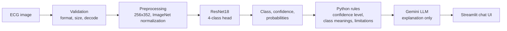

# CardioLens AI

[](https://cardiolens-ai-ml.streamlit.app/)

**ECG image classification with a plain-language explanation.**
A ResNet18 CNN classifies an ECG image into one of four classes. A large language model then explains the prediction and answers follow-up questions in English or Bangla. The model decides; the LLM only explains and never diagnoses.

> **Educational prototype only. This is not a medical device and not a diagnosis.**
> A qualified healthcare professional must interpret every ECG.

## Live demo

**https://cardiolens-ai-ml.streamlit.app**

Free hosting can put inactive apps to sleep. If the page asks you to wake the app, confirm and wait a moment.

## Table of contents

- [Overview](#overview)
- [How it works](#how-it-works)
- [Dataset and data cleaning](#dataset-and-data-cleaning)
- [Model and training](#model-and-training)
- [Results](#results)
- [LLM explanation layer and safety design](#llm-explanation-layer-and-safety-design)
- [API reference](#api-reference)
- [Project structure](#project-structure)
- [Getting started](#getting-started)
- [Testing](#testing)
- [Privacy](#privacy)
- [Limitations](#limitations)
- [Future work](#future-work)

## Overview

ECG reports are hard for non-experts to read. CardioLens AI shows how a model prediction can be explained in simple language while keeping the decision with a measurable model and keeping the LLM away from medical judgment.

**Features**

- Transfer learning with an ImageNet-pretrained **ResNet18**, fine-tuned for four classes
- Class-weighted loss and a stratified **5-fold cross-validation** protocol
- **Gemini** explanations in English or Bangla; follow-up answers use the language the user writes in
- Safety by design: the LLM never receives the image, confidence levels are computed in code, and a strict system prompt forbids diagnosis and treatment advice
- **FastAPI** backend with upload validation and in-memory chat sessions
- **Streamlit** UI with a result card, quick-question buttons and an action row under each answer (copy, listen, thumbs up/down, analyze again, share, download)
- Automated **pytest** suite for the data index, dataset, model, training behavior, inference, LLM layer and API

## How it works



| Component | Role |
|---|---|
| `src/` | Data index, Dataset, model, training, inference, LLM layer |
| `app/main.py` | FastAPI backend: `/predict`, `/chat`, `/feedback`, `/health` |
| `ui/streamlit_app.py` | Streamlit front end, talks to the API over HTTP |

**Classes:** Normal, Abnormal Heartbeat, Myocardial Infarction (MI), History of MI.

## Dataset and data cleaning

The images come from the Mendeley Data collection **"ECG Images dataset of Cardiac Patients"** (12-lead ECG images in four class folders):
https://data.mendeley.com/datasets/gwbz3fsgp8/2

Please cite the original authors and check the dataset page for the license and the preferred citation. Related publication: Khan et al., "ECG Images dataset of Cardiac and COVID-19 Patients", *Data in Brief* 34 (2021) 106762.

**Cleaning pipeline**

1. The class label is taken from the folder name.
2. An MD5 hash of the raw bytes is computed for every file.
3. Files with an identical hash are exact duplicates. One copy is kept (928 files become **491 unique images**).
4. A safety check confirms that no hash appears under two different classes (0 conflicts).
5. The unique images are split into **5 stratified folds** (`random_state=42`), so every fold keeps the class ratio.

| Class | Original files | Unique images | Share after cleaning |
|---|---|---|---|
| Normal | 284 | 142 | 28.9% |
| Abnormal Heartbeat | 233 | 233 | 47.5% |
| Myocardial Infarction | 239 | 30 | 6.1% |
| History of MI | 172 | 86 | 17.5% |
| **Total** | **928** | **491** | |

Removing duplicates is what exposed a strong class imbalance: the MI class has only 30 unique images. This is handled with class weights, stratified folds, and macro-F1 and per-class recall as the main metrics.

The index files `data/clean_index.csv` (path, label, hash) and `data/folds.csv` (adds the fold) are generated by `src/make_folds.py` and can be rebuilt at any time.

## Model and training

| Item | Setting |
|---|---|
| Architecture | ResNet18, ImageNet-pretrained, new `Linear(512, 4)` head (about 11.2 M parameters) |
| Fine-tuning | All layers are trained |
| Input | RGB, resized to 256x352 (aspect ratio preserved), ImageNet mean/std normalization |
| Augmentation | None (baseline) |
| Loss | Cross-entropy with class weights computed from the training folds |
| Optimizer | Adam, learning rate 1e-4 |
| Batch size / epochs | 16 / 4 |
| Seed / hardware | 42 / CPU |

**Evaluation protocol:** for each of the 5 runs, 4 folds train the model and 1 fold validates it. The reported number for each run is the metric of the **last epoch**, not the best epoch, so the score is not inflated by picking the best epoch on validation data.

**Final model:** after cross-validation, one model is trained on all 491 images with the same settings. It has no separate validation set, so its expected quality is the cross-validation result below.

## Results

5-fold cross-validation, last epoch, recall per class:

| Fold | Macro-F1 | Abnormal | History of MI | MI | Normal |
|---|---|---|---|---|---|
| 0 | 0.928 | 0.978 | 0.889 | 0.833 | 0.931 |
| 1 | 0.885 | 0.936 | 0.882 | 0.667 | 0.964 |
| 2 | 0.864 | 0.957 | 0.647 | 0.833 | 1.000 |
| 3 | 0.795 | 0.894 | 0.941 | 0.333 | 0.964 |
| 4 | 0.893 | 0.848 | 0.941 | 1.000 | 1.000 |
| **Mean ± std** | **0.873 ± 0.049** | 0.923 ± 0.052 | 0.860 ± 0.122 | **0.733 ± 0.253** | 0.972 ± 0.029 |

Raw numbers: `outputs/cv_results.csv`.

How to read this:

- Macro-F1 gives each class the same weight, which matters because of the imbalance. Plain accuracy would hide poor results on the small classes.
- The MI recall of 0.73 means 22 of the 30 MI images were found across the five folds. In medicine, a missed MI (false negative) is the most costly error, so this is the weakest result of the project.
- The MI result swings between 0.33 and 1.00 from fold to fold because each fold contains only 6 MI images.
- There is no separate hold-out test set. See [Limitations](#limitations).

## LLM explanation layer and safety design

- The LLM (Gemini, `gemini-3.1-flash-lite`) **never sees the ECG image**. It receives only the predicted class, confidence, class probabilities, class meanings and the model limitations.
- The confidence level (`high`, `moderate`, `low`) and the class meanings are defined in Python code, not left to the LLM. Scores of 99% or more are displayed as ">99%" because a neural network is never truly certain.
- The system prompt forbids diagnosis and treatment advice, requires advice to seek emergency care when the user mentions symptoms such as chest pain, tells the model to ignore requests to change its rules, and asks it to answer in the user's language.
- Each analysis has a chat session that keeps the conversation history, so follow-up questions work.
- Calls use a 30 second timeout and up to 3 attempts with exponential backoff.
- Risk remains: LLMs can make mistakes. The explanation layer has no formal evaluation yet.

## API reference

| Method | Endpoint | Description |
|---|---|---|
| GET | `/health` | Service status |
| POST | `/predict` | `multipart/form-data`: `file` (JPEG or PNG, up to 10 MB) and `language` (`English` or `Bangla`). Returns the prediction and a `session_id` |
| POST | `/chat` | JSON: `session_id`, `question` (`null` for the first explanation). Returns `answer` |
| POST | `/feedback` | JSON: `session_id`, `message_index`, `rating` (`up` or `down`) |

Example `/predict` response (illustrative values):

```json
{
  "session_id": "3f2a...",
  "confidence_level": "high",
  "predicted_class": "Normal",
  "confidence": 0.91,
  "probabilities": {"Abnormal": 0.04, "History_of_MI": 0.02, "MI": 0.03, "Normal": 0.91}
}
```

Upload validation rejects wrong formats (415), oversized files (413), images that are too small or too large (422), and unreadable or corrupted files (400). Interactive documentation is available at `/docs` when the API is running.

## Project structure

```text
CardioLens_AI/
├── app/
│   └── main.py              FastAPI backend
├── ui/
│   ├── streamlit_app.py     Streamlit front end
│   └── action_bar/          custom component for the answer action row
├── src/
│   ├── make_folds.py        deduplication and stratified folds
│   ├── dataset.py           Dataset and transforms
│   ├── model.py             ResNet18 with a 4-class head
│   ├── train.py             training and evaluation (one fold per run)
│   ├── train_final.py       final model on all data
│   ├── predict.py           inference class
│   └── explain.py           LLM explanation layer
├── tests/                   pytest suite
├── notebooks/               exploration and experiments
├── data/                    clean_index.csv and folds.csv (images are not committed)
├── models/                  model metadata and weights
├── outputs/                 cross-validation results
├── requirements.txt
├── requirements-dev.txt
└── .env.example
```

## Getting started

**Requirements:** Python 3.11 or newer. Developed and tested on Ubuntu 24.04.

```bash
git clone https://github.com/mahmudulhasan3/CardioLens_AI.git
cd CardioLens_AI

python -m venv venv
source venv/bin/activate
pip install -r requirements.txt

cp .env.example .env
# open .env and set GEMINI_API_KEY
```

The default Linux wheel of PyTorch is large because it includes CUDA libraries. For a smaller CPU-only install:

```bash
pip install torch torchvision --index-url https://download.pytorch.org/whl/cpu
pip install -r requirements.txt
```

**Configuration**

| Variable | Used by | Description |
|---|---|---|
| `GEMINI_API_KEY` | backend | Required. The backend refuses to start without it |
| `API_URL` | UI | Backend address, default `http://127.0.0.1:8000` |

### Run the app

```bash
# Terminal 1: backend
python -m uvicorn app.main:app --reload

# Terminal 2: UI
python -m streamlit run ui/streamlit_app.py
```

Open http://localhost:8501.

### Reproducing the model

The ECG images and the trained weights are large files. To rebuild the model:

1. Download the dataset from the link above and place the four original class folders inside `data/`. The class label is derived from the folder name, which must contain one of: `myocardial`, `abnormal`, `history`, `normal person`.
2. Run the pipeline from the project root:

```bash
python -m src.make_folds                                                    # dedup + 5 folds
for f in 0 1 2 3 4; do python -m src.train --val-fold $f --epochs 4; done   # cross-validation
python -m src.train_final                                                   # final model on all data
python -m src.predict "path/to/an_ecg_image.jpg"                            # test one image
```

Cross-validation metrics are appended to `outputs/cv_results.csv`; delete that file before a fresh run.

## Testing

```bash
pip install -r requirements-dev.txt
python -m pytest -q
```

The suite checks the data index (size, class counts, no duplicate hashes, stratified folds), the Dataset and transforms, the model shape, training behavior (loss decreases on a small batch, validation does not change weights, class weights, reproducibility), inference output, the LLM layer (retry and history handling with a fake client, so no real API call is made) and the API (validation errors, sessions, feedback). Tests that need the data or the trained model are skipped automatically when those files are missing.

These tests verify that the code behaves correctly. Model quality is measured separately by the cross-validation above.

## Privacy

- The ECG image is processed by the backend and is **not sent to the LLM** and not stored.
- `/feedback` stores only a timestamp, session id, message index, rating and the predicted class and confidence level. It stores no chat text and no image.
- Chat sessions live in server memory and are lost on restart (at most 200 are kept).
- The API key is read from the `.env` file, which is excluded from version control.

## Limitations

- **Small dataset:** 491 unique images, of which only 30 are MI. MI results are unstable.
- **Weak MI recall:** 0.73 ± 0.25 in cross-validation.
- **No separate test set:** all images were used in cross-validation. A held-out or external test set would give a more honest estimate.
- **Single source:** results on ECGs from other hospitals, devices or scan styles are unknown.
- **Near-duplicates:** only exact duplicates (identical bytes) were removed; re-saved or slightly edited copies would not be detected.
- **Closed set:** the model always returns one of the four classes, even for a non-ECG image. Only format and size checks exist.
- **Confidence is not a probability of disease** and has not been calibrated; the confidence level thresholds (0.85 and 0.60) are untuned.
- **No clinical validation.** Labels were not independently verified by the author.
- **LLM output can be wrong** and has no formal evaluation.
- Only ResNet18 was tried; no other architectures were compared and no augmentation was used.

## Future work

- Reject non-ECG images (embedding-distance check)
- Grad-CAM to inspect where the model looks
- Augmentation and model comparison (for example EfficientNet-B0, ResNet50) under the same 5-fold protocol
- Evaluation on an independent external dataset
- Perceptual-hash check for near-duplicates and a patient-level split, if patient identifiers exist
- Probability calibration
- An evaluation set for the LLM answers (guardrails, language, safety)
- Persistent sessions and request logging

## Disclaimer

CardioLens AI is a student project for learning and demonstration. It must not be used to make medical decisions. If you have symptoms such as chest pain, shortness of breath or fainting, seek emergency medical care.

## Author

**Mahmudul Hasan** CSE Student, NITER | Aspiring AI Engineer

GitHub:[@mahmudulhasan3](https://github.com/mahmudulhasan3)

LinkedIn:[@mahmudulhasan03](https://www.linkedin.com/in/mahmudulhasan03/)